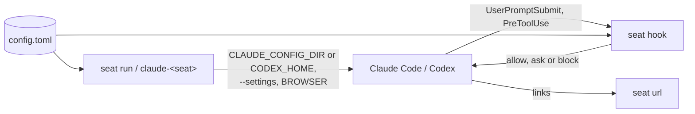

# Architecture

seatwise is one binary, `seat`, over one config file. Nothing runs in the background unless you schedule the sentinel.
Claude Code and Codex call back into `seat` through their hooks, and `BROWSER` points at `seat` for seats whose links go
somewhere other than the system default.

## Modules

One module per concern, in `src/`:

| Module | What it owns |
|---|---|
| `config` | `config.toml`: seats, folders, presets, groups, sentinel options, and their validation |
| `edit` | Changing `config.toml` from commands and the TUI while keeping the user's comments and layout |
| `paths` | Where things live; every location can be moved with an environment variable |
| `folders` | Which seat owns a path: the longest configured folder that contains it |
| `guard` | The hook decisions: folders a seat may touch, prompts in the wrong folder or org |
| `claude` | Claude Code's and Codex's own files: the signed-in account, hooks in `settings.json` / `hooks.json` |
| `launch` | Starting an agent on the right seat with its environment, settings layers and preset |
| `preset` | Use-case presets for folder groups, resolved the same way every time, and `seat explain` |
| `draft`, `wizard` | Building a preset one valid choice at a time (`seat preset new/edit/set`), and the step-by-step wizard over it |
| `catalog` | The settings catalog (`catalog/claude-code.toml`): every Claude Code setting and env var, where it's honored, and checks |
| `plan`, `usage` | The seat's plan, usage profiles sized to it, and the rate limits used |
| `sentinel` | Fixed checks for costly settings, the report, notifications and the OS scheduler entries |
| `privacy` | Redaction of account identifiers whenever an agent may read seatwise's output |
| `init` | Finding existing config folders and proposing a config |
| `status`, `doctor`, `ps` | `seat list`, `seat doctor`, `seat ps` |
| `link` | Where a seat's links go |
| `shell`, `shim` | Shell functions per seat, and the optional `claude` command that runs `seat run auto` |
| `term`, `hybrid`, `skills`, `home` | The desktop app and terminal side by side, the installed skills, home repos |
| `share`, `sync` | Copying setup between seats, and settings snapshots |
| `view` | The Seat view and the Project view: everything about a seat or a project folder in one value, for `seat show`, `seat projects` and the TUI |
| `tui` | `seat tui`: renders the views, and drives a preset draft in its editor |

## Determinism

Given the same config, folder and seat, seatwise always produces the same settings. Folder ownership and folder groups
both use the longest matching path; presets merge in a fixed order and never touch hooks; the session settings carry a
fingerprint (`SEATWISE_PRESET=name@hash`) so `seat ps` shows which sessions run on which settings.

## Tests

`tests/cli.rs` runs the real binary against temporary folders with fake `claude` and `codex` binaries that print what
they were started with. Unit tests sit next to the code they test.
